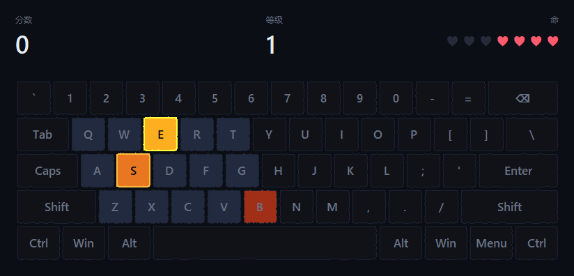
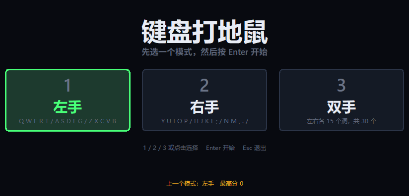

# 键盘打地鼠 · KeyMole

用**键盘自己的 RGB 灯**当显示屏的打地鼠游戏：灯亮在哪个键上，就在那个键上打它。




纯 Python 标准库实现（tkinter 画屏幕、winsound 出声、ctypes 直接跟 HID 设备对话），
没有任何第三方依赖。

## 为什么做这个

大多数「键盘灯效软件」只让你选预设动画。但键盘的灯本质上是一个
**低分辨率、大面积、贴着手指的显示器** —— 它其实可以显示游戏状态。
打地鼠是最适合这个显示器的第一个游戏：地鼠只需要亮一个键，
而你的手本来就放在那一片键上。

## 玩法

- 菜单里选 **左手 / 右手 / 双手**（1 / 2 / 3 或直接点卡片）
- Enter 开始，空格暂停，Esc 回菜单
- 地鼠亮**红色**，越接近超时会闪得越快；打中绿闪 + 加分，按错蓝闪 + 扣分
- 难度会随等级上升（停留时间变短、同屏地鼠变多），每升一级回一条命

## 能适配到哪一步

| 通道 | 覆盖 | 能力 | 状态 |
|---|---|---|---|
| OpenRGB SDK | 六百多型号 | 逐键 / 分区自动降级 | 协议自研实现，对假服务器验证通过 |
| 罗技 LED SDK | 罗技 G 系列 | 逐键 | 代码就绪，需 G HUB 运行 |
| 雷蛇 Chroma SDK | 雷蛇 | 逐键 | 代码就绪，需 Synapse |
| 迈从 Ace68（实验） | 迈从 CZ 系列 | 逐键 128 颗 | **真机验证可用** |
| Win11 LampArray | HID 标准 | 逐键 | 只做探测（本机无设备） |
| 屏幕虚拟键盘 | 100% | 完整游戏 | 始终可用 |

认不出键名会自动降级：逐键 → 分区 → 整块 → 屏幕。
先跑 `python -m keymole.probe` 看你这台机器能到哪一级。

## 快速开始

```bash
python -m keymole          # 打开游戏
python -m keymole.probe    # 看通道探测结果
python -m keymole.devices  # 列出所有 HID 设备及其报文通道
```

打包成 exe：

```bash
python -m PyInstaller --noconfirm --clean --windowed --name KeyMole ^
  --icon keymole/docs/keymole.ico --collect-submodules keymole --paths . run_keymole.py
```

> `--collect-submodules keymole` 不能省。设备后端是动态导入的，
> 少了它 exe 里扫出来的后端数量会是 0，只能跑屏幕版。

安装包：`python installer_gui.py`（安装向导，可自定义路径），
或 `python install.py`（脚本安装，装到 `%LOCALAPPDATA%\Programs\KeyMole`）。

## 迈从 Ace68 是怎么接上的（方法记录）

厂商没有公开 SDK，所以是这么挖的：

1. 官方 HUB 是 Electron，主进程是 V8 字节码读不动，但**渲染层是从 CDN 加载的明文 JS**
2. 用 `--remote-debugging-port=9222` 起一个独立 profile 的实例，用 CDP 注入脚本
   给 `HIDDevice.prototype.sendReport` 打日志，抓到了真实报文
3. 从 CDN 的 `CZ_SHARED_DATA` SDK 源码里对上字段含义，得到：
   - 64 字节输出报文，report id 0，`55 0B 00 <校验> 38 <地址低> <地址高> <页> + RGB`
   - 地址是**字节偏移**（= 3 × 灯号），每包 54 字节（18 颗灯）
   - 校验 = `sum(frame[4:]) & 0xFF`
4. 键号表来自 CDN 的 `default-keys-ace68_i.js` 与 `layout-ace68_i.js`

**这些细节只用于让自己买的键盘显示自己的游戏**，不涉及绕过任何授权。
如果你想加别的型号，`keymole/display/vendor/` 下每个文件都是一个
`probe()` + `make()` 的小模块，照着 ace68.py 抄就行。

## 键盘灯的几个坑（都踩过了）

- **键盘会静默吞包**：`WriteFile` 返回成功不代表灯变了。这台键盘每秒只吃约 55 个报文
- **固件会自己重绘**：只发一次会「亮一下就灭」，必须持续刷新
- **不能并行发**：同时到达的多个输出报文会被丢掉，必须逐包串行
- **保活不能太稀**：0.1 秒补发一次，中间会被固件刷掉，看起来就是「没亮」
- **退出要还原**：退出时通过 CDP 把 HUB 原来的灯效配置写回去

现在的策略：一帧最多 2 包、变化的包优先、没变化时轮转保活、每 0.7 秒清一遍其余包，
实测「提交 → 上灯」中位 5ms。

## 自测

```bash
python -m tools.test_orgb        # OpenRGB 协议（假服务器）
python -m tools.test_orgb_zones  # 分区降级
python -m tools.test_orgb_game   # 整局跑在假键盘上
python -m tools.test_mchose      # 迈从 0x55 协议组包
python -m tools.smoke_input      # 真发按键，验证 按键→命中→渲染
```

## 目录结构

```
keymole/
  core/       游戏逻辑（不碰 GUI 和硬件）
  render.py   状态 → 一帧 {键: (r,g,b)}
  display/    同一帧喂给不同后端：screen / openrgb / vendor/*
  audio.py    标准库合成音效
  detect.py   通道探测与降级
  app.py      tkinter 主循环
tools/        协议测试、抓包、调参、冒烟脚本
```

## 许可

MIT。仅供个人使用与学习。
