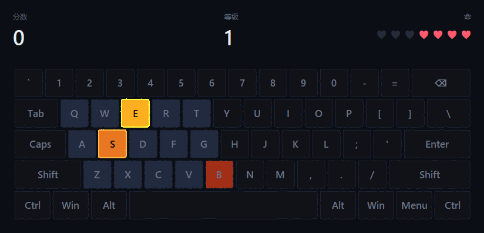

# KeyMole · 键盘打地鼠

把键盘当屏幕：灯亮在哪个键上，就在哪个键上把地鼠敲掉。



*左边三列（Q W E R T / A S D F G / Z X C V B，共 15 个洞）是打地鼠区。
现亮的三只是同一时刻、不同"年龄"的地鼠：**金色=刚冒头，红色=要跑了**。*

---

## 怎么玩

```bash
python -m keymole.probe           # 第一步：看这台机器能到哪一级（推荐）
python -m keymole                 # 开玩
python -m keymole --mock          # 没硬件也能看到"真机逐键"的样子（内置假键盘）
python -m keymole --mute          # 静音
python -m keymole --simulate 120  # 不上屏，让机器人跑 120 秒，看难度曲线
```

| 键 | 作用 |
| --- | --- |
| `Q W E R T` `A S D F G` `Z X C V B` | 打地鼠（只有这 15 个是洞） |
| 其他任何键 | 不惩罚，随便按（手放着不动也不会扣分） |
| `Esc` / `Enter` | 退出 / 结束后重来 |

地鼠停留 1.55s → 0.45s（随难度变短），超时掉一条命；按在**空洞位上**扣 25 分并清空连击；
连击每 +1 给 +10% 分，最高 ×3；每升一级回一条命（上限 7 条）。窗口失焦自动暂停。

**声音不是装饰**：眼睛在键盘上，看不见屏幕，得靠听辨「地鼠冒头」和「漏掉」。

---

## 能适配到哪一步（这张表是重点）

"适配大部分键盘"卡在硬件上，不是卡在代码上 —— 一个键有没有自己的 RGB，由键盘设计和固件决定。
所以 KeyMole 不做单点方案，而是**同时带四条通道，按能力自动挑最好的一条**：

| 通道 | 需要什么 | 能拿到 | 覆盖 |
| --- | --- | --- | --- |
| **OpenRGB**（自研协议客户端） | 装 OpenRGB + 打开 SDK Server（6742） | 逐键 **或** 分区（自动降级） | 几十品牌、六百多型号，面最广 |
| **罗技 LED SDK** | G HUB 在跑 + 插罗技键盘 | 逐键 | 罗技全家桶 |
| **雷蛇 Chroma SDK** | 装 Razer Synapse | 逐键 | 雷蛇全家桶 |
| **迈从 MCHOSE**（实验） | 插迈从键盘（本机 G87/K87 V3） | 逐键 | 协议已还原，物理通道验证中 |
| **Win11 动态光效 (HID LampArray)** | Win11 + 键盘符合标准 | 逐键 | 新标准，正在变多（本机只做探测） |
| **屏幕虚拟键盘** | 无 | 屏幕 | 永远可用，也当真机灯效的预览器 |

`python -m keymole.probe` 会逐条打印 `[OK]/[--]`、**为什么**不 OK、以及"想往上一级该装什么"。

能力分级（游戏永远能玩，只是灯效降级）：

| 等级 | 能力 | 打地鼠体验 |
| --- | --- | --- |
| L3 | 逐键 | 完整版：地鼠真的亮在键上 |
| L2 | 分区 | 地鼠亮在它所在的那一区（左/中/右），仍能玩 |
| L1 | 整块单色 | 只剩命中绿闪 / 漏掉红闪的氛围反馈，主要靠屏幕 |
| L0 | 无灯 | 屏幕画一块虚拟键盘，手照敲真键盘 —— 完全体可用 |

### L2 降级是这版的关键一步

市面上一大半带灯键盘没有逐键协议，但**几乎都有分区**（单区 / 三区 / 四分区的 RGB）。
`keymole/display/openrgb.py` 打开设备时先看能不能把 LED 名字认成键名：

- 认得出 ≥6 个洞位 → 逐键（L3）；
- 认不出 → 改用设备的 zone 列表，把 15 个洞位按竖条切给各区，**每个区显示它那片里最要紧的颜色**（L2）；
- 只有一个区 → 整块当氛围灯（L1）。

所以"不支持逐键"的键盘不再等于"不能玩"。

> 实测：迈从 MCHOSE G87 V3（2.4G 无线）用厂商私有协议、被官方 HUB 独占，
> 没有公开 SDK，OpenRGB 也还没支持 → 它只能 L0。它确实暴露了 `FF70/FF80/FF81`
> 几条厂商 HID 通道，但报文格式没公开，逆向成本高（见"下一步"）。

---

### 迈从通道：协议是从官方 HUB 的前端里读出来的

迈从没有公开 SDK，OpenRGB 也没有 MCHOSE 驱动。但 MCHOSE HUB 是 Electron，
它的渲染层 bundle（7.7MB 明文 JS）被 Chromium 缓存留在了
`%APPDATA%\MCHOSEHUB\Cache\Cache_Data\` 里（gzip 压缩，解出来就是完整灯效引擎）。
从里面读出的逐键灯效格式，已实现为 `keymole/display/vendor/mchose.py`：

| 项 | 值 |
| --- | --- |
| 载荷 | 8 字节头 + 18列×6行×3 字节网格 + 14 字节 empty15 + 14 字节（`00 00 5A A5 …`） = **360 字节** |
| 键偏移 | `8 + (col*6 + row)*3`，例如 q=32 w=50 e=68 / a=35 s=53 d=71 / z=38 x=56 c=74 |
| 无线 | report id `0x13`，命令 `0x09`(setLightColor)，每片 14 字节、共 **26 片**，末字节是十进制累加校验 |
| 有线 | report id `6`，`sendFeatureReport`，补零到 **519 字节** |
| 读状态 | `getBattery=0x4A`、`getLightColor=0x49`，输入报文前三字节 = [cmd, total, seq] |

`python -m keymole.mchose_test --seconds 8` 会把 15 个洞位按行染成红/绿/蓝推过去。
**能写进去 ≠ 灯会亮**：本机实测 `FF70` 写入成功但收不到任何 ACK，`FF80` 被系统拒写
（`err=87`）、`FF81` 更不行。所以这一步需要人眼确认，见「已知限制」。

### 为什么「检测到键盘」不等于「能点灯」

先把两件事分开：

- **检测到** 只要求它是个 HID 键盘 —— 插上就有，任何键盘都过。
- **能点灯** 要求固件额外开一条控制通道 —— 这是厂商自己决定的，不统一。

`python -m keymole.devices` 会把每个设备的「通道类型」打出来，这正是排查"我这块键盘到底行不行"的命令：

```
MCHOSE G87 V3 2.4G       VID_3837&PID_1015  厂商私有页 0xFF70,0xFF80,0xFF81（未公开，需逆向）
Ace68-II                 VID_41E4&PID_2116  私有报文通道 in=65 out=65（无私有页，疑似厂商控制）
HID VHF Driver           VID_5E2A&PID_71B4  纯输入设备，没有点灯通道
```

判定规则（`keymole/devices.py`）：

| 特征 | 结论 |
| --- | --- |
| usage page `0x59` | Win11 LampArray，标准通道，可点灯 |
| usage page `0xFF60` | VIA/QMK raw HID，可点灯（要看固件真实现） |
| 其它 `0xFF00+` 页 | 厂商私有页，报文未公开 |
| 只有 `0x01`，但带 32 字节以上的收发报文 | **疑似把控制通道藏在键盘接口里** —— 没有厂商页 ≠ 没有控制通道 |
| 只有 `0x01` 且报文都很小 | 纯输入设备，只能读按键 |

这条表解释了最常见的困惑：一块键盘插上就被认出来了，但它的灯归厂商软件独占。

## 架构：三层 + 一个契约

```
core/       纯游戏逻辑（不 import 任何 GUI / 硬件）
  ↓         状态
render.py   把状态渲染成一帧 {逻辑键: (r,g,b)}
  ↓         同一帧喂给所有后端
display/    screen.py · openrgb.py · zones.py · vendor/logitech.py · vendor/razer.py
```

关键决定：

- **渲染循环而不是"点亮一个键"**。灯效本质是整帧 framebuffer 提交，每帧只改几个像素，
  所以 `render.build_frame()` 返回整帧，后端负责 diff / 提交。
- **丢帧不排队**。真实键盘固件往往只有 20–30Hz，排队会让延迟越堆越高；
  `Display.offer()` 到点才提交，没到点直接丢弃这一帧。
- **读键不需要 SDK**。按键本来就进操作系统，监听窗口事件即可；SDK 只用于点灯。
- **不写手工 keymap**。键位靠 LED 名字（`Key: A`）或分区来对，认不出的洞位自动从候选池消失。
- **屏幕后端同时是预览器**。同一帧颜色，屏幕上看到什么，真机就是什么。

### OpenRGB 通道是自己实现的协议客户端

不依赖 `openrgb-python`：`keymole/display/orgb.py` 直接按 OpenRGB 的
`NetworkServer` 协议（`ORGB` 包头 + u32 包号 + u16 长度前缀字符串 + `RGBColor`）通信，
声明 protocol 3。好处是"一条命令装完就能玩"，坏处得自己维护解析器。

```bash
python -m keymole.setup_openrgb --start   # 下载 + 解压 + 起 SDK Server
python -m keymole.probe                   # OpenRGB 应该变成 [OK]
python -m keymole                         # 自动挑最好的通道，不必指定
```

（下载慢的话也可以自己从 openrgb.org 下 Windows 包，再 `--start`。）

---

## 难度校准

`tools/tune_difficulty.py` 让三种"人类"各打 24 局：

| 玩家 | 存活中位数 | 中位得分 | 到得了的等级 |
| --- | --- | --- | --- |
| 菜鸟（出手率 92%→55%） | 38s | ~7.0k | 3 |
| 普通（97%→72%） | 68s | ~21.8k | 5 |
| 高手（99.5%→88%） | 101s | ~48.3k | 7 |

改 `keymole/core/game.py` 里的 `Config` 后跑一遍就能看曲线有没有变味。

## 自测

```bash
python -m tools.test_orgb         # 协议 + 逐键（对内置假键盘）
python -m tools.test_orgb_zones   # L2 分区降级
python -m tools.test_orgb_game    # 整局游戏跑在假键盘上
python -m tools.smoke_input       # 真发 Windows 按键，验证按键→命中→渲染
python -m tools.test_mchose       # 迈从报文格式（离线，不碰硬件）
python -m keymole.mchose_test     # 真机推一帧迈从灯效，靠眼睛确认
python -m tools.probe_via         # 我的键盘说 VIA / QMK raw HID 吗
python -m keymole.devices         # 插着的键盘各自有没有点灯通道
python -m keymole.probe           # 这台机器最高能玩到哪一级
```

## 已知限制

- 无线模式下很多键盘灯效刷新率极低，逐键玩必须插线。
- 厂商软件常把灯效锁在"内置灯效"，要切到直接控制 / 静态模式，并保持常驻。
- 罗技 / 雷蛇通道的代码路径没有对应硬件验收过（本机只有接收器，没插键盘；
  雷蛇连 Synapse 都没装）。OpenRGB 通道用假服务器逐字节验证过。
- Win11 LampArray 只做了探测，没做点灯实现（本机 0 个设备，验证不了就不硬写）。
- 迈从通道：报文格式已完整还原，`FF70` 能写进去，但还没看到灯亮、也没收到 ACK。
  可能是 2.4G 休眠，也可能这条集合不是真正的灯效端点（有线用的是 report id 6 + 519 字节 feature）。
- 全键盘高亮会明显发热，长时间玩建议降亮度或缩小洞位区。

## 下一步

0. **迈从通道收尾**：协议已还原，剩下的是确认物理端点 —— 用 `mchose_test` 肉眼看灯；
   若无线不认，就插线走 report id 6 / 519 字节 feature 那条路；
   再不行就用 USBPcap 抓一次 HUB 的报文做逐字节对比（需要管理员权限）。
1. **打字练习模式**：逐键灯最大价值其实在这里 —— 一直高亮"下一个该按的键"。
2. **LampArray 实现**：等有符合标准的键盘就补上，这条路覆盖面会涨得最快。
3. **QMK 固件内版本**：把游戏搬进 `rgb_matrix`，延迟 <1ms 且不依赖电脑。

## 安装 / 桌面快捷方式

```bat
python -m PyInstaller --noconfirm --clean --windowed --name KeyMole ^
  --icon keymole/docs/keymole.ico --paths . run_keymole.py
python install.py
```

- `install.py` 把 `dist/KeyMole/` 复制到 `%LOCALAPPDATA%\Programs\KeyMole`，再用 COM(`IShellLink`) 在**桌面**和**开始菜单**建「键盘打地鼠」快捷方式（不依赖 pywin32 / PowerShell）。
- `python install.py --uninstall` 或双击 `卸载.bat` 卸载。
- 分发包：`dist/KeyMole-安装包.zip`（解压后双击 `安装.bat`）。
- 打包脚本入口是仓库根的 `run_keymole.py`；`_ensure_stdio()` 负责把 windowed exe 里为 None 的 stdout/stderr 接到 devnull，否则 `print` 会炸。

## 打包与安装（踩过的坑）

- **必须加 `--collect-submodules keymole`**。设备后端是动态导入的
  （`detect._vendor_backend()` 里 `importlib.import_module("keymole.display.vendor.ace68")`），
  PyInstaller 静态分析看不到，漏掉之后 exe 里扫描结果是 `backends=0`，
  表现为「源码跑正常、装好的 exe 永远只有屏幕版」。
- 安装包结构：`dist/package/KeyMole/`（程序）+ `install.py` + `shortcut.py` + 两个 bat。
- 图标：`KeyMole.ico` 要复制进安装目录，快捷方式指向它而不是 exe
  （`SetIconLocation` 的第一个参数是纯路径，不能带 `,0`；
  本机用 ctypes 调 IShellLink 写不进图标，改用 `cscript` 跑临时 .vbs）。
- 安装向导 `installer_gui.py` 支持自定义路径 + 浏览文件夹，`--silent` 走 `KEYMOLE_INSTALL_DIR`。

## 灯效刷新策略（Ace 68）

键盘每秒只吞得下约 55 个输出报文，所以：

- 15 个洞位都落在 **0–3 号包**，一帧最多发 **2 个包**
- 有变化 → 先发变化的包（新地鼠 1 包就上灯，实测中位 5ms）
- 没变化 → 轮转发 1 个包保活（固件会自己重绘，只发一次会亮一下就灭）
- 每 0.7 秒顺带把其余包压一遍，保持熄灭

## 启动与重连

- 每次启动都会重新枚举 HID、逐个试开，结果写进 `.keymole.log`
- 菜单底部显示当前通道：「灯效：Ace68-II（L3 逐键）　F5 重新连接」
- **F5 是全局热键**（不看窗口焦点）：拔插键盘、2.4G/有线切换、HUB 抢设备之后按一下
- 退出时通过 CDP 把 HUB 原来的灯光配置还原回去
